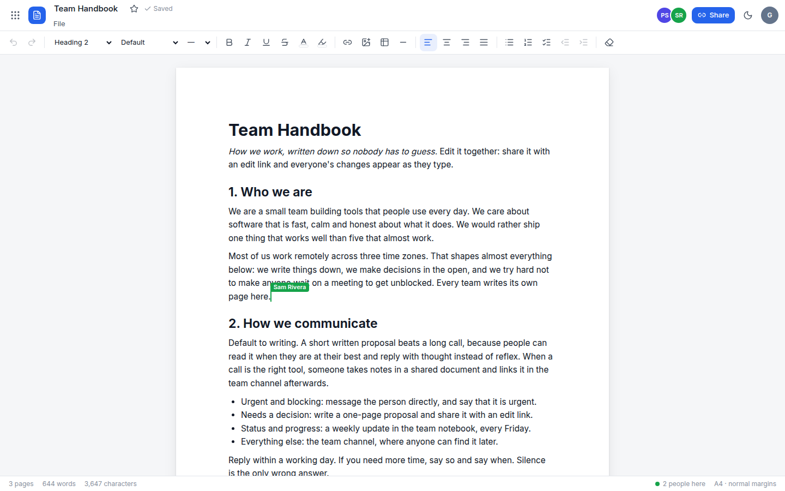
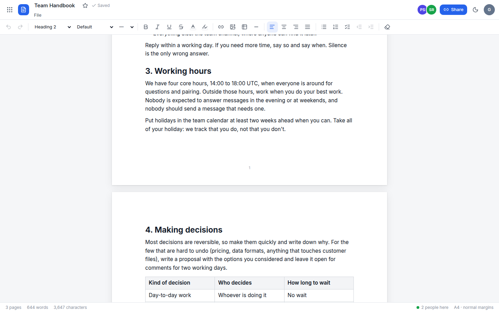
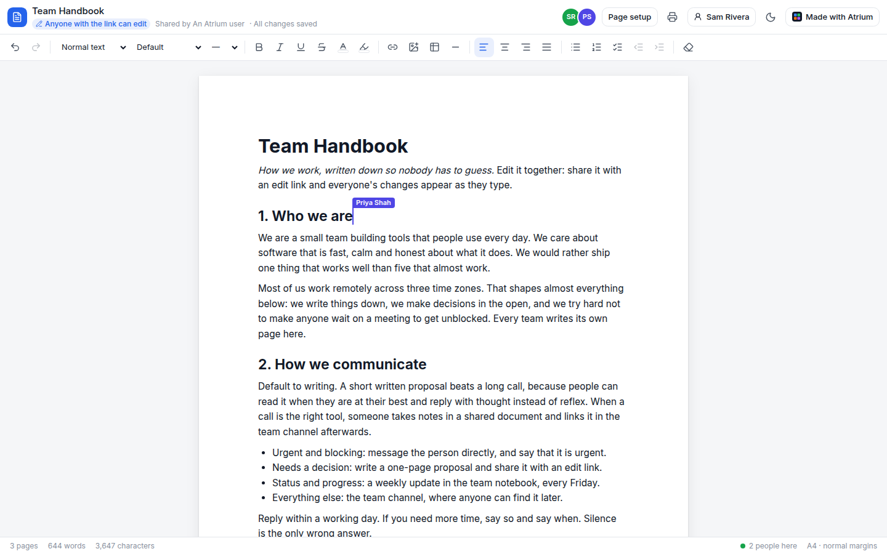
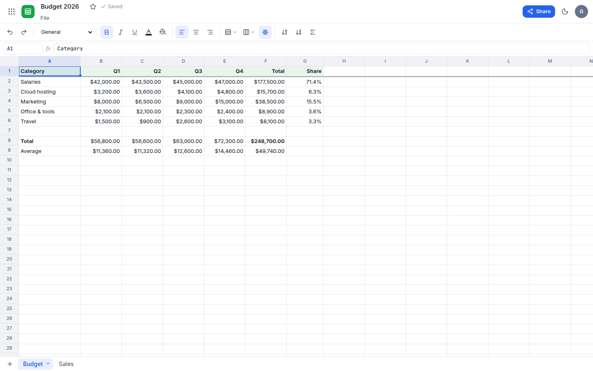
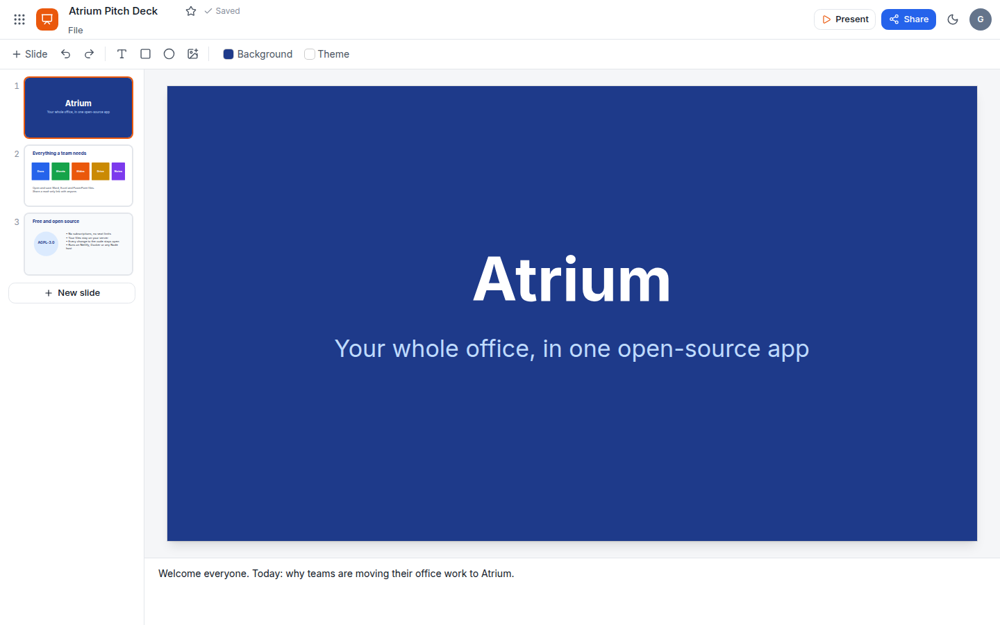
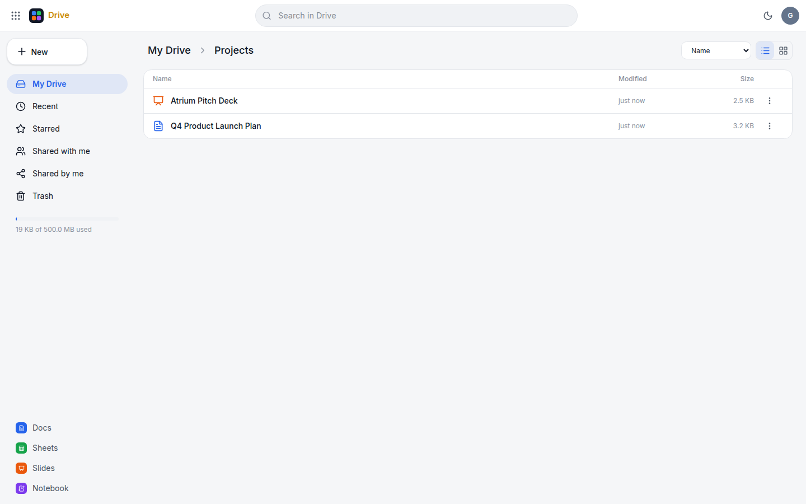
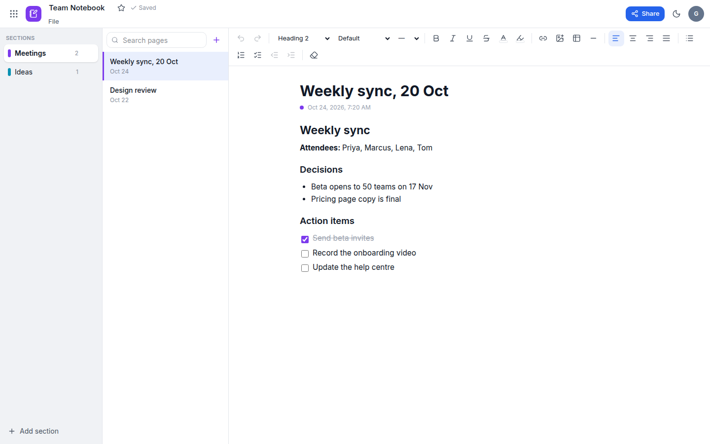
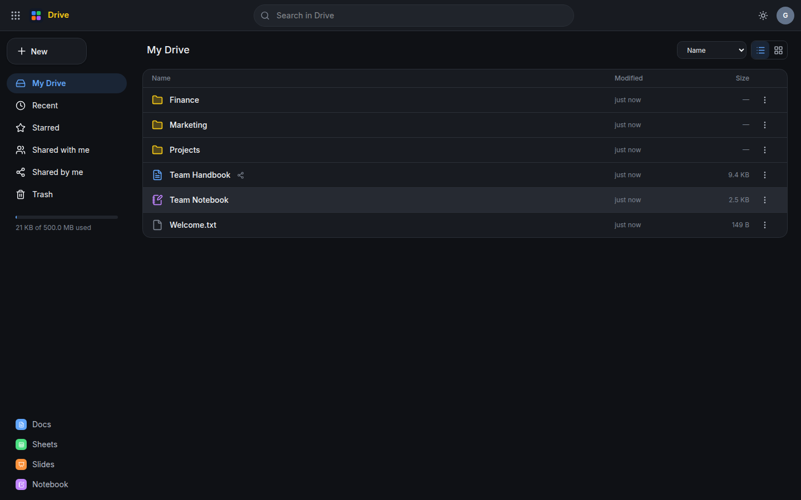

<div align="center">


# Atrium

**A free, open-source office suite: Docs, Sheets, Slides, Drive and Notebook in one Next.js app.**

Like Microsoft 365 or Zoho Workplace, without the subscription. It opens and saves Word, Excel and PowerPoint files.

[](LICENSE)
[](https://github.com/amanjhacodes55/atrium/actions/workflows/ci.yml)
[](https://nextjs.org)
[](https://www.typescriptlang.org)
[](https://app.netlify.com/start/deploy?repository=https://github.com/amanjhacodes55/atrium)

[**Live demo**](https://atrium-office.netlify.app) · [**Watch the demo video**](docs/media/atrium-demo.mp4) · [Quick start](#quick-start) · [Docs](#documentation)

</div>

[](docs/media/atrium-demo.mp4)

Office software is something everyone needs and few people want to rent. Atrium puts the five everyday tools in one
workspace with one login and one drive, runs on a free Netlify site or any server, and is licensed under the AGPL so it
stays free for everyone.

Try it at **[atrium-office.netlify.app](https://atrium-office.netlify.app)**. Click *Try it without an account* to get a
workspace with sample files in every app.

## The apps

**📝 Docs**: a word processor you can write in together
- **Real-time co-editing, like Google Docs.** Share an edit link and everyone types in the same document at once,
  with each person's cursor and name on the page and avatars of who is here. No account needed to join.
- **Real pages.** A4 or Letter sheets with margins and page numbers. Text flows from page to page line by line, lists
  split between items, and printing breaks exactly where the screen does.
- Headings, fonts, sizes, colours, highlights, alignment, lists, checklists, quotes, code, links, images and tables
  with resizable columns. Page and word count.
- Opens Word files (.docx). Downloads as Word, PDF, HTML or Markdown.

**📊 Sheets**: a spreadsheet
- About 400 Excel-compatible functions (`SUM`, `VLOOKUP`, `INDEX`/`MATCH`, `IF`, dates, text and more) from
  [HyperFormula](https://hyperformula.handsontable.com/), with references between tabs (`Sheet2!A1`).
- Number, currency, percent and date formats, bold, italic and underline, text and fill colours, alignment, sorting,
  a frozen header row, resizable columns and multiple tabs.
- Keyboard navigation and copy/paste that works with Excel and Google Sheets. SUM, average and count of the selection.
- Opens and saves Excel (.xlsx) and CSV.

**📽️ Slides**: presentations
- Text boxes, rectangles, ellipses and images that you drag, resize and snap to guides.
- Layouts, themes, background colours and speaker notes.
- Full-screen presenter with keyboard control.
- Opens and saves PowerPoint (.pptx), and prints to PDF.

**🗂️ Drive**: file storage
- Folders, drag-and-drop uploads, and previews for images, video, audio, PDF and text.
- Search, star, rename, move (by dragging too), copy, trash and restore. Shows how much storage you have used.
- *Shared by me* and *Shared with me* views.
- Upload a .docx, .xlsx, .csv or .pptx file and open it in Atrium.

**📓 Notebook**: notes like OneNote
- Notebooks with coloured sections and pages.
- Rich text, checklists and images on every page, and search across all your pages.

**Across the suite**
- **Autosave**: every change is saved within a second, and the save is retried if you go offline.
- **Share by link**: a public link for any file, as *Viewer* or (for documents) *Editor*, which you can turn off at
  any time. Viewers watch edits land live. Links you open while signed in collect under **Shared with me**.
- **Templates**: meeting notes, a resume, a project proposal, a budget, an invoice, a pitch deck, a journal and more.
- **Guest workspaces**: anyone can try the app without signing up, and keep their files by signing up later.
- **Light and dark themes**, with an app launcher like Microsoft 365's.

## Screenshots

<table>
  <tr>
    <td width="50%"><br /><sub><b>Docs</b>: write together live, with each person's cursor and name</sub></td>
    <td width="50%"><br /><sub><b>Real pages</b>: text flows from page to page, headings stay with their paragraph</sub></td>
  </tr>
  <tr>
    <td><br /><sub><b>Edit links</b>: anyone with the link joins without an account</sub></td>
    <td><br /><sub><b>Sheets</b>: Excel formulas, formats and tabs</sub></td>
  </tr>
  <tr>
    <td><br /><sub><b>Slides</b>: build a deck, then present it full screen</sub></td>
    <td><br /><sub><b>Drive</b>: folders, uploads, previews, Shared with me</sub></td>
  </tr>
  <tr>
    <td><br /><sub><b>Notebook</b>: sections, pages and checklists</sub></td>
    <td><br /><sub><b>Dark mode</b> throughout</sub></td>
  </tr>
</table>

## Quick start

You need Node.js 20.9 or newer.

```bash
git clone https://github.com/amanjhacodes55/atrium.git
cd atrium
npm install
npm run dev
```

Open <http://localhost:3000>. Accounts and files are stored in `./.data`. There is no database to set up.

### Deploy to Netlify

[](https://app.netlify.com/start/deploy?repository=https://github.com/amanjhacodes55/atrium)

Atrium stores everything in [Netlify Blobs](https://docs.netlify.com/blobs/overview/), which every Netlify site gets
automatically, so there are no environment variables to set. Or deploy with the CLI:

```bash
npx netlify-cli deploy --build --prod
```

### Docker

```bash
docker compose up -d
```

Data is kept in the `atrium-data` volume. See [self-hosting](docs/self-hosting.md) for settings and backups.

## Documentation

| Guide                                     | What is in it                                                                 |
| ----------------------------------------- | ----------------------------------------------------------------------------- |
| [HTTP API](docs/api.md)                   | Every endpoint, with request and response shapes and the four file formats.  |
| [Self-hosting](docs/self-hosting.md)      | Netlify, Docker and Node, settings, backups and the storage layout.          |
| [Architecture](docs/architecture.md)      | How the pieces fit, autosave, safe concurrent writes and security.           |
| [Contributing](CONTRIBUTING.md)           | Development setup and guidelines.                                             |
| [Security](SECURITY.md)                   | How to report a vulnerability, and a hardening checklist.                     |

### Use the API

Everything the web app does is a JSON API call, so you can script it. For example, to create a spreadsheet:

```bash
curl -c jar -H 'content-type: application/json' -d '{"email":"you@example.com","password":"…"}' \
  https://atrium-office.netlify.app/api/auth/login
curl -b jar -H 'content-type: application/json' https://atrium-office.netlify.app/api/items \
  -d '{"kind":"sheet","name":"Invoices"}'
```

See the [API reference](docs/api.md) for every endpoint.

## How it is built

| Part            | Technology                                                                                             |
| --------------- | ------------------------------------------------------------------------------------------------------ |
| App             | [Next.js 16](https://nextjs.org) (App Router), React 19, TypeScript, Tailwind CSS 4                    |
| Docs, Notebook  | [TipTap](https://tiptap.dev) (ProseMirror); [mammoth](https://github.com/mwilliamson/mammoth.js) and [docx](https://docx.js.org) for Word |
| Live editing    | [Yjs](https://yjs.dev) CRDT relayed over HTTP polling, so it runs on serverless functions with no socket server |
| Sheets          | [HyperFormula](https://hyperformula.handsontable.com/) for formulas; [ExcelJS](https://github.com/exceljs/exceljs) for .xlsx |
| Slides          | A custom canvas editor; [PptxGenJS](https://gitbrent.github.io/PptxGenJS/) and JSZip for .pptx         |
| Storage         | Netlify Blobs on Netlify, plain files everywhere else                                                  |
| Auth            | Email and password (scrypt), hashed session tokens in an HttpOnly cookie                              |

The editors do all their work in the browser, including imports and exports. The server only stores JSON and files,
so it runs comfortably on free serverless functions. More in [architecture](docs/architecture.md).

## Development

```bash
npm run dev         # start on http://localhost:3000
npm run lint        # ESLint
npm run typecheck   # TypeScript
npm test            # Vitest: drive, auth, live editing, formulas, Word, Excel and PowerPoint conversion
npm run build       # production build
```

The demo video is recorded from the running app with Playwright and narrated with
[Kokoro](https://github.com/thewh1teagle/kokoro-onnx); the script is in [`docs/video`](docs/video).

## Roadmap

Comments and suggestions in Docs, version history, live co-editing in Sheets and Slides, folder sharing, mail and
calendar. Ideas and pull requests are welcome.

## ☕ Buy me a coffee

I build Atrium on my own time and keep it free for everyone. If it saved you time, taught you something, or powers
something you're building, a coffee is the kindest way to say thanks, and every one buys me more hours to build
and improve Atrium and my other open-source projects.


**UPI ID: `8941951465@axl`** (or **+91 8941951465**). Scan the code with Google Pay, PhonePe, Paytm, BHIM or
any UPI app; international payments are welcome too.

However small, every coffee keeps the work going. Thank you!

## Licence

Atrium is free software: you can redistribute it and/or modify it under the terms of the
[GNU Affero General Public License v3.0 or later](LICENSE).

In short, you may use, study, change and share Atrium for any purpose, including commercially. If you distribute a
changed version, **or run one as a service that others use over a network**, you must publish your changes under the
same licence. That keeps Atrium and every improvement to it open for everyone.

HyperFormula is used under its GPLv3 licence, which is compatible with the AGPL.
